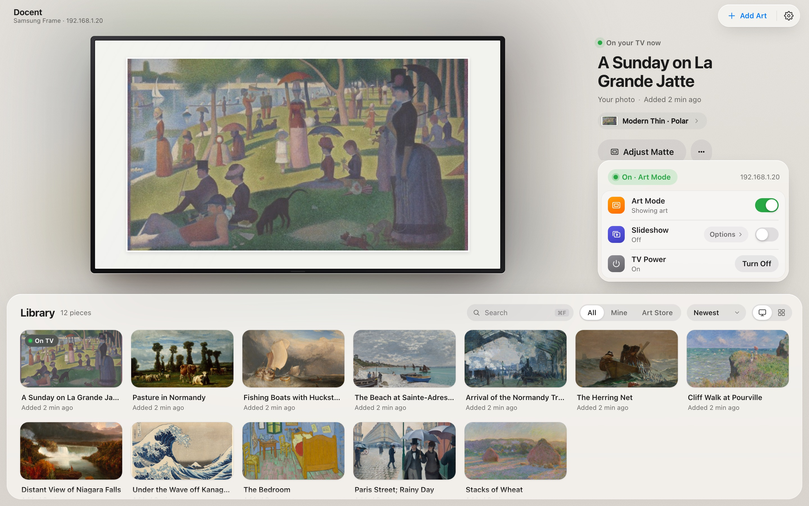
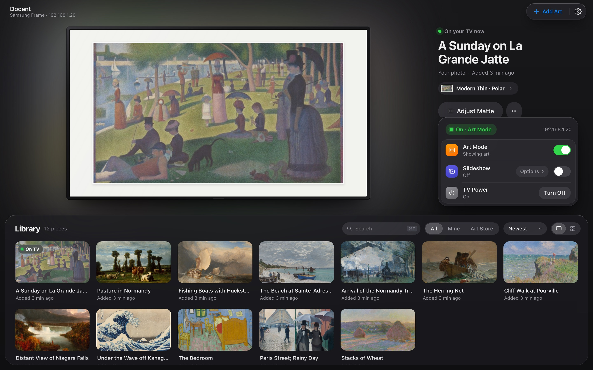
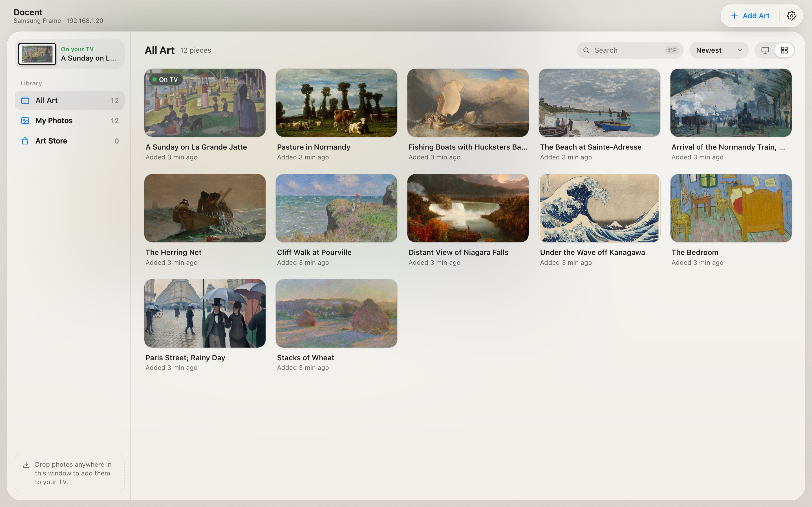

<h1> Docent</h1>

A local curator for your Samsung Frame TV — a tiny web dashboard for Art Mode.
Runs on your own machine, talks to the TV over your LAN — no cloud, no account.



> **Status:** macOS-first, single-user, single-TV. Built and tested on a Frame
> Pro 2026 (LS03HW). Should work on any Frame with the Tizen WebSocket API
> (Frame 2021+). The FastAPI server is portable and likely runs on Linux;
> only the optional menu bar widget and launchd auto-start are Mac-only.

## What it does

- Browse your TV's Art Mode library with thumbnails.
- See what's on screen; click any other image to switch.
- Drag-and-drop upload personal photos — auto-padded to 3840×2160, deduped by hash.
- Per-image matte picker (10 styles × 16 colors), rename, delete.
- Power / Art Mode toggle, plus a built-in slideshow with shuffle and interval.
- Live status (10s polling) — IP, current image, art mode, online/offline.
- Light and dark mode, a full-window library view, and a TV bezel picker to match your frame.
- Optional native Mac app (`Docent.app`) and a menu bar widget.

| Dark mode | Library view |
|---|---|
|  |  |

<sub>Screenshots use demo mode with public-domain paintings from the Art Institute of Chicago.</sub>

## Quickstart

Requires Python 3.10+ and a Samsung Frame TV on the same Wi-Fi as your computer.

```bash
git clone https://github.com/doaxs/docent.git
cd docent
python3 -m venv venv
source venv/bin/activate
pip install -r requirements.txt

./run.sh
```

Then open <http://127.0.0.1:8000>.

**First run:** the dashboard scans your network for Samsung TVs. Click the
one you want; your TV will show a pairing prompt — accept it with your
remote within ~30 seconds. The dashboard remembers your TV via a token
stored in `data/tv_token.txt`. No `.env` file required.

**Tip:** give the TV a fixed IP (a DHCP reservation in your router) so Docent
doesn't lose it when the lease renews.

**Your originals stay where they are.** Docent sends a resized copy to the TV
and doesn't keep the original file, so keep your own backups.

### Mac app

To run Docent in its own window instead of a browser tab:

```bash
pip install -r requirements-desktop.txt
./build_app.sh
open dist/Docent.app      # or drag it to /Applications
```

## Optional: always-on dashboard + menu bar widget (macOS)

If you want the dashboard running 24/7 with a menu bar icon showing live
TV status, see [`docs/MENUBAR.md`](docs/MENUBAR.md). Heads up: there's a
macOS Full Disk Access gotcha if your clone lives under `~/Documents/` —
the doc walks through it.

## Troubleshooting

**"No Samsung TVs found on this network."**
Make sure the TV is on (Art Mode counts), and on the same Wi-Fi/subnet as
your computer. Some routers isolate Wi-Fi clients from each other ("AP
isolation" or "guest network") — turn that off, or wire your computer to
the same network. As a fallback, click *Enter IP manually* and use the
TV's IP from your router admin page.

**The pairing prompt never appears on the TV.**
Some Frame firmwares only show the prompt while Art Mode is active. Press
the Art Mode button on your remote, then re-trigger from the dashboard.

**It worked yesterday but now says "TV unreachable."**
Most likely the TV's IP changed (DHCP renewed). Click the IP in the status
bar to re-scan and pick the TV again — or set a static reservation in
your router so the IP doesn't drift. If the token has gone stale, delete
`data/tv_token.txt` and re-pair.

**A matte type returns a 502.**
Some matte types only accept exact 16:9 source images. Photos uploaded
through the dashboard are always padded to 16:9 and accept all types.
Items already on the TV from before may only accept `flexible_*` and
`shadowbox_*` mattes — pick one of those.

## Stack

- FastAPI + Jinja2 (server-rendered HTML)
- HTMX 2 for live partials — no JS framework, no build step
- [`samsungtvws`](https://github.com/xchwarze/samsung-tv-ws-api) for the
  unofficial Tizen WebSocket API
- Pillow for image processing
- SQLite for upload metadata; filesystem cache for thumbnails

## Project layout

```
docent/
├── app/
│   ├── main.py              # FastAPI routes
│   ├── config.py            # settings
│   ├── tv.py                # samsungtvws wrapper (singleton, locked)
│   ├── discovery.py         # SSDP scan for TVs on the LAN
│   ├── imaging.py           # upload pipeline (resize, pad, dedupe)
│   ├── slideshow.py         # app-side slideshow daemon
│   ├── db.py                # SQLite metadata layer
│   ├── templates/
│   └── static/
├── launchd/                 # optional: macOS LaunchAgent
├── swiftbar/                # optional: macOS menu bar plugin
├── tools/                   # diagnostic scripts (frame_check.py, probe_thumbs.py)
├── docs/                    # firmware quirks, menu bar setup
├── data/                    # gitignored — token, thumbs, sqlite
├── requirements.txt
└── run.sh
```

## Contributing

Issues and PRs welcome. [`CLAUDE.md`](CLAUDE.md) covers the architecture and
conventions (it doubles as context for Claude Code). Use demo mode for UI
work so you don't change what's on your wall:

```bash
python tools/fetch_demo_art.py           # once: 12 public-domain paintings into demo-data/
DOCENT_DEMO=1 DATA_DIR=demo-data ./run.sh
```

Demo mode fakes the TV and builds its library from the JPEGs in
`$DATA_DIR/thumbs/`. `DOCENT_DEMO_STATE=unreachable` or `pairing` shows those
screens.

Known firmware quirks are in [`docs/FIRMWARE.md`](docs/FIRMWARE.md). If you
hit a new one on another model, please include:

- TV model number (Settings → Support → About this TV)
- Tizen / firmware version
- The specific API call that misbehaved (look for `TV call:` lines in
  your terminal or `data/launchd.err.log`)

## License

[MIT](LICENSE).

## Acknowledgments

Wouldn't exist without [`xchwarze/samsung-tv-ws-api`](https://github.com/xchwarze/samsung-tv-ws-api),
which reverse-engineered Samsung's Tizen WebSocket API.

Docent is an independent project, not affiliated with or endorsed by Samsung.
Samsung and The Frame are trademarks of Samsung Electronics.
